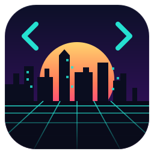
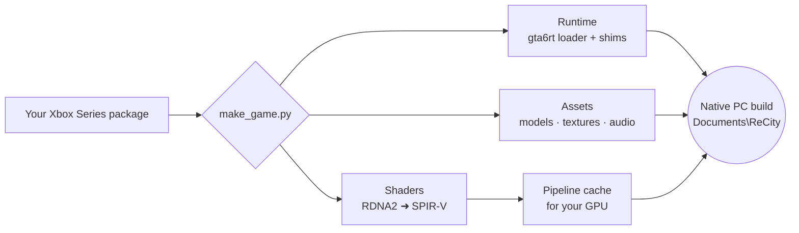

<div align="center">



# Project ReCity

**The next big open-world city, rebuilt natively for the PC — from the copy you already own.**

A static recompilation of Grand Theft Auto VI (Xbox Series, v1.0.2.1) into a native Windows program with a Vulkan
renderer. You bring the game. ReCity brings the toolchain.

[](https://github.com/pixl27/ProjectReCity/actions/workflows/ci.yml)
[](https://github.com/pixl27/ProjectReCity/actions/workflows/runtime.yml)
[](https://github.com/pixl27/ProjectReCity/actions/workflows/no-game-data.yml)


[Quick start](#-quick-start) · [Where we are](#-where-we-are) · [Roadmap](ROADMAP.md) · [Changelog](CHANGELOG.md) ·
[Building in depth](docs/BUILDING.md) · [Contribute](#-join-in)

</div>

---

## 🌆 The idea

Consoles and PCs now speak the same CPU language. The Xbox Series runs x86-64, so the game's machine code does not
need an emulator: ReCity loads it like any Windows program and swaps the console's system libraries for its own.
What *does* need translating is the graphics: every precompiled AMD RDNA2 GPU program in the game is rewritten as
SPIR-V and handed to Vulkan, and the console's flavour of Direct3D 12 is rebuilt on top of Vulkan.



Everything happens locally. Nothing from the game is in this repository, nothing is downloaded, and nothing the build
produces should ever leave your machine.

> [!WARNING]
> **ReCity contains no game files, no keys and no executable, and it will not tell you how to obtain them.** It only
> reads a package whose files are already plain on disk; it does not decrypt anything or bypass any protection. The
> shaders, assets and saves it generates come from *your* copy — keep them to yourself.

## 📍 Where we are

**The game does not boot yet.** Everything that can be prepared without the game's executable is prepared, so the
first real boot attempt can start the day a developer has one.

| Area | Progress | Notes |
|---|---|---|
| 🔍 Copy detection & checks |  | v1.0.2.1, every file's size and SHA-256 |
| 🎨 Shader extraction |  | carve → unpack → disassemble |
| 🧠 Shader translation (RDNA2 → SPIR-V) |  | all pass `spirv-val` with LLVM 21; LLVM 23 still rejects 1,471 |
| 🌊 Wave64 on NVIDIA / Intel |  | compute & mesh exact via emulation; VS/PS/GS cross-half ops approximate |
| 🧪 Translator on real GPUs |  | NVIDIA Turing→Blackwell, AMD GCN3→RDNA4, Intel, Apple M1, llvmpipe |
| 🧱 Models |  | OBJ with names, UVs, materials; some layouts still rejected |
| 🖼️ Textures |  | DDS export; BCPack pool entries skipped for now |
| 🔊 Audio |  | lossless Ogg Opus, PCM WAV, XMA2 via ffmpeg |
| 📻 Radio & music data |  | 1,589 records with exact durations; no per-track offsets |
| ⚙️ Loader & system shims |  | runs a test executable end to end; never met the real one |
| 🖥️ Xbox D3D12 → Vulkan |  | resources, barriers, copies, queries work; no pipelines, draws or present yet |
| 🎮 Playable |  | — |

The full breakdown, with the evidence behind every line, lives in [ROADMAP.md](ROADMAP.md).

## 🚀 Quick start

You need your own copy of the Xbox Series package (v1.0.2.1), a Windows 10/11 PC and roughly **350 GB** of scratch
space.

```powershell
git clone --recursive https://github.com/pixl27/ProjectReCity
cd ProjectReCity
.\Build.bat
```

`Build.bat` hunts for your game folder (Downloads, Desktop, Documents, Games, your home folder and every drive root),
checks the tools below, and writes the result to `Documents\ReCity`. Interrupted? Run it again — it picks up where it
stopped.

<details>
<summary><b>Tools to install first</b></summary>

| Tool | Why |
|---|---|
| [Python 3.12+](https://www.python.org/downloads/) | runs the build (tick *Add python.exe to PATH*) |
| [.NET 8 SDK](https://dotnet.microsoft.com/download/dotnet/8.0) | asset exporter |
| [Vulkan SDK](https://vulkan.lunarg.com/) | `spirv-as`, `spirv-val` |
| LLVM 21+ **with the AMDGPU target** | shader disassembly — `scripts\build_llvm_mc.ps1` builds one for you |
| Visual Studio 2022 (C++ workload, Windows SDK 10.0.26100+) | compiles the runtime |
| [ffmpeg](https://ffmpeg.org/download.html) *(optional)* | XMA2 audio and `--wav` |

</details>

Command-line options, Linux, Wine/Proton and the wave64 switch are covered in
**[docs/BUILDING.md](docs/BUILDING.md)**.

## 🗺️ Find your way around

| You want to… | Go to |
|---|---|
| build or tweak the build | [docs/BUILDING.md](docs/BUILDING.md) |
| understand the shader translator's contract | [docs/design.md](docs/design.md) |
| follow the D3D12 → Vulkan work | [docs/d3d12_vulkan.md](docs/d3d12_vulkan.md) |
| read up on a file format | [docs/README.md](docs/README.md) |
| hack on the loader | [`runtime/`](runtime/README.md) |
| see what's planned | [ROADMAP.md](ROADMAP.md) |

| Folder | What lives there |
|---|---|
| `make_game.py`, `Build.bat` | the one-click build |
| `tools/` | shader carving, translation, asset indexing, research helpers (Python, stdlib only) |
| `tools/rpf9dump/` | bulk asset exporter (.NET) |
| `runtime/` | `gta6rt`: PE loader, system shims, D3D12 → Vulkan layer, tests |
| `game/` | per-version file manifests |
| `viewer/` | browser map viewer for the exported world |
| `tests/` | ~3,000 unit tests that need no game data |

## ❓ FAQ

**Can I play it?** Not yet. See [Where we are](#-where-we-are).

**Will you share a ready-made build?** No. ReCity is built on your PC from your copy, and its output must stay there.

**Why Xbox and not PlayStation?** The Xbox Series CPU and executable format are close enough to Windows that the game
code can run natively; only the system libraries and the GPU need rebuilding.

**Which GPUs?** Anything with a modern Vulkan driver. AMD runs 64-wide shader waves natively; NVIDIA and Intel use the
built-in wave64 emulation, switched on automatically.

**What is actually in this repository?** Tooling only: build scripts, the shader translator, asset readers and the
runtime. It holds no code or assets from the game, needs your own copy to do anything, and is not affiliated with
the game's publisher.

## 🤝 Join in

The most valuable work right now: the first frame on screen through D3D12 → Vulkan (milestones M0–M2), wave64
cross-half code on 32-wide GPUs, and the model layouts the decoder still rejects.

1. Pick something from [ROADMAP.md](ROADMAP.md) and claim it in [issue #1](https://github.com/pixl27/ProjectReCity/issues/1).
2. Read [CONTRIBUTING.md](CONTRIBUTING.md) (and [AGENTS.md](AGENTS.md) if an AI helps you).
3. Run the GPU tests and post your card's results in [issue #2](https://github.com/pixl27/ProjectReCity/issues/2).

Never attach game files, extracted assets or generated shaders to an issue or pull request.

---

## License and credits

Project ReCity is free software under the **GNU General Public License v3.0 or later**; see [LICENSE](LICENSE).
Third-party code keeps its own license.

- Project ReCity is derived from Leonida by ItsNotRexed and contributors (GPL-3.0-or-later), and has been modified
  since 2026-11-22; [CHANGELOG.md](CHANGELOG.md) lists the changes. The full authorship is in the git history.
- [rpf9-explorer](https://github.com/breadbbbb/rpf9-explorer) by breadbbbb: the RPF9 model, texture-pool and AWC
  decoders used by `tools/rpf9dump` (git submodule).
- [Mesa](https://gitlab.freedesktop.org/mesa/mesa) (MIT): GFX10 resource-descriptor layout
  (`tools/gfx10_formats.json`) and ACO/RADV reference rules.
- [libHttpClient](https://github.com/microsoft/libHttpClient) (MIT) by Microsoft: XTaskQueue/XAsync in
  `third_party/xtaskqueue`.
- [LLVM](https://llvm.org/) (AMDGPU disassembler) and [SPIRV-Tools](https://github.com/KhronosGroup/SPIRV-Tools)
  (assembly and validation).

Grand Theft Auto and all related names are trademarks of their owners. This project is not affiliated with or
endorsed by them.
